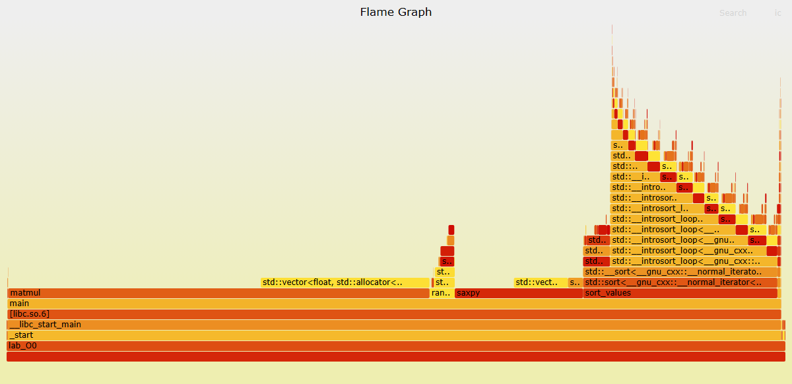
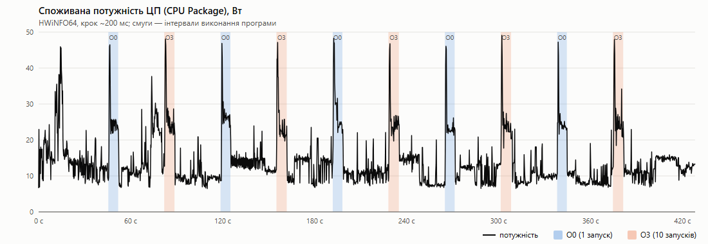
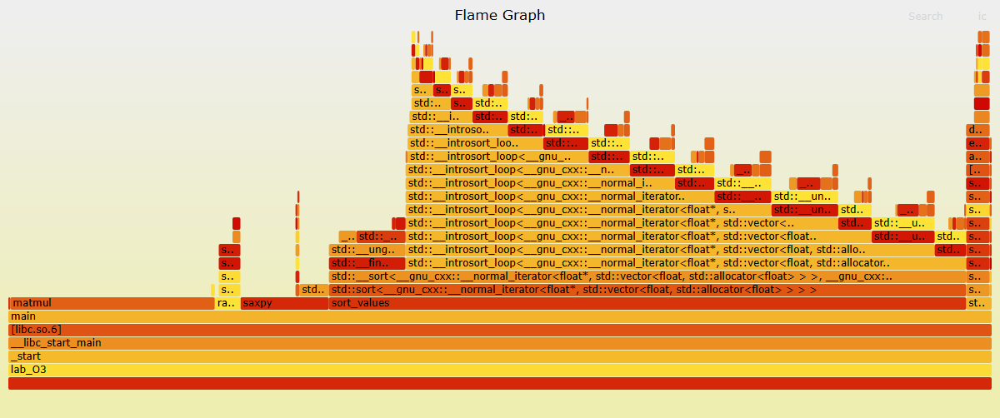
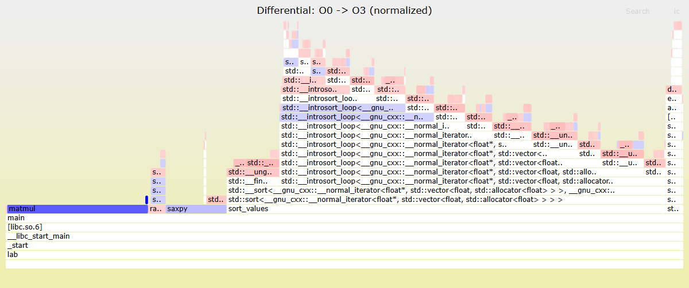

# Лабораторна робота 2. Профілювання, енергоспоживання та оптимізація програми

## Середовище

| | |
|---|---|
| Процесор | Intel Core i5-12450H (Alder Lake, 4 P-ядра + 4 E-ядра, L3 12 МБ) |
| Ноутбук | Acer Nitro AN515-58 |
| ОС | Windows 10 Pro 22H2, WSL2 + Ubuntu 22.04 |
| Компілятор | g++ 11.4.0 |
| Профілювальник | perf 5.15, FlameGraph (Brendan Gregg) |
| Вимірювання потужності | HWiNFO64 8.54 |

## Програма

Код: [src/lab.cpp](src/lab.cpp)

Програма складається з п'яти функцій з різним характером навантаження:

| Функція | Що робить |
|---|---|
| `randomize` | заповнює масив випадковими числами (`std::mt19937`) |
| `matmul` | множення матриць 1024×1024 (float), порядок циклів i-k-j |
| `saxpy` | `y = a*x + y` для 1 млн елементів, 200 повторів |
| `length` | сума квадратів елементів з накопиченням у `double` |
| `sort_values` | `std::sort` для 5 млн float |

Функції позначені `__attribute__((noinline))`, щоб після оптимізації вони не вбудовувались у `main` і залишались окремими блоками на FlameGraph.

Розміри задаються аргументами: `./lab_O0 [n] [повтори saxpy] [кількість елементів для сортування]`, за замовчуванням `1024 200 5000000`.

Збірка двох версій:

```bash
g++ -O0 -g -fno-omit-frame-pointer lab.cpp -o lab_O0
g++ -O3 -march=native -g -fno-omit-frame-pointer lab.cpp -o lab_O3
```

Обидві версії дають однаковий результат: `n=1024 len=314924 median=0.499925`.

### Налаштування perf у WSL2

Ядро WSL зібране Microsoft, тому пакетний `perf` треба викликати напряму з `/usr/lib/linux-tools/*/perf`. Перед роботою:

```bash
sudo sysctl -w kernel.perf_event_paranoid=-1
sudo sysctl -w kernel.kptr_restrict=0
```

Апаратні лічильники (cycles, instructions, cache misses) у WSL2 на Windows 10 недоступні: гіпервізор Hyper-V не віртуалізує PMU процесора, і perf показує для них `<not supported>`. Тому для `perf record` використовується програмна подія `cpu-clock`.

---

## 1. FlameGraph

### 1.1 Побудова

```bash
perf record -e cpu-clock -F 999 --call-graph dwarf ./lab_O0
perf script > out_O0.perf
~/FlameGraph/stackcollapse-perf.pl out_O0.perf > out_O0.folded
~/FlameGraph/flamegraph.pl out_O0.folded > flame_O0.svg
```

- `-e cpu-clock` - семплювання по таймеру, бо апаратна подія `cycles` недоступна;
- `-F 999` - 999 семплів на секунду;
- `--call-graph dwarf` - відновлення стеку викликів за налагоджувальною інформацією DWARF;
- `stackcollapse-perf.pl` згортає кожен стек в один рядок `main;matmul;... кількість`;
- `flamegraph.pl` будує з цього інтерактивний SVG.

Спочатку графік будувався з `-g` (розкрутка стеку через frame pointer, регістр `rbp`). На ньому з'явився широкий блок `std::vector<float>::operator[]` (~15%) прямо над `main`, хоча `main` цей оператор майже не викликає. Причина: `operator[]` при `-O0` дуже коротка функція, і коли семпл потрапляє на її пролог (`push rbp` ще не виконано) або епілог (`pop rbp` вже виконано), `rbp` вказує на кадр `matmul`, тому perf пропускає `matmul` і прив'язує `operator[]` до `main`. З `--call-graph dwarf` стек відновлюється правильно, і цей артефакт зникає.

Файли: [flamegraphs/flame_O0.svg](flamegraphs/flame_O0.svg) (інтерактивний, відкривати локально у браузері), [flamegraphs/out_O0.folded](flamegraphs/out_O0.folded).



### 1.2 Інтерпретація

Вісь X показує не час, а частку семплів (частку процесорного часу), блоки на одному рівні впорядковані за алфавітом. Вісь Y - глибина стеку викликів: внизу процес і `main`, вище функції, які вони викликають. Ширина блоку - частка часу, яку функція разом зі своїми нащадками провела на CPU. Найбільше часу витрачається там, де є широкі блоки без нічого над ними ("плоскі верхівки").

Розподіл часу для O0 (загалом 4,70 с CPU):

| Функція | Частка | Час |
|---|---|---|
| `matmul` | 54,1% | 2542 мс |
| `sort_values` | 25,0% | 1172 мс |
| `saxpy` | 16,5% | 774 мс |
| `randomize` | 3,2% | 152 мс |
| конструктори `std::vector` | 0,5% | 22 мс |
| `length` | 0,1% | 4 мс |

Що видно на графіку:

- Нижні рівні `lab_O0 -> _start -> __libc_start_main -> main` займають усю ширину, бо весь код виконується всередині них.
- `matmul` - найширший блок. Над ним стоїть `std::vector<float>::operator[]`, який займає ~40% часу `matmul`. При `-O0` компілятор не вбудовує функції, і кожне звернення `a[i*n+k]`, `b[k*n+j]`, `c[i*n+j]` - це окремий виклик функції. Решта ~60% - тіло циклу самої `matmul`.
- `sort_values` утворює найвищу "вежу": `std::sort -> std::__sort -> std::__introsort_loop -> std::__introsort_loop -> ...`. Це рекурсія introsort (quicksort з переходом на heapsort/insertion sort). Висота вежі відповідає глибині рекурсії, приблизно log2(5*10^6) ≈ 22. Частка кожного наступного рівня менша, бо на глибших рівнях сортуються менші підмасиви. Зверху видно `__unguarded_partition` (розбиття навколо опорного елемента), `__insertion_sort`, компаратор `_Iter_less_iter::operator()` та оператори ітераторів.
- `saxpy` також має над собою блоки `operator[]` і `size()`, бо `y.size()` викликається на кожній ітерації.
- `randomize` і `length` займають мало.

Висновок: при `-O0` значну частину часу програма витрачає не на арифметику, а на виклики дрібних функцій стандартної бібліотеки (`operator[]`, `size()`, оператори ітераторів, компаратор), кожен з яких - це `call`, пролог, кілька `mov` через стек і `ret`.

---

## 2. Статистика виконання

### 2.1 /usr/bin/time --verbose

```bash
/usr/bin/time --verbose ./lab_O0
```

Повний вивід: [results/time_O0.txt](results/time_O0.txt)

| Параметр | Значення | Пояснення |
|---|---|---|
| User time | 4,65 с | час виконання коду програми в режимі користувача |
| System time | 0,00 с | час у ядрі; програма не працює з файлами чи мережею, тільки один раз виділяє пам'ять |
| Percent of CPU | 98% | (user + sys) / elapsed, програма однопотокова |
| Elapsed (wall clock) | 4,71 с | реальний час, майже дорівнює user time, тобто програма обмежена процесором (CPU-bound) |
| Maximum resident set size | 35 436 КБ | пік фізичної пам'яті: 3 матриці по 4 МБ + масив 20 МБ = 32 МБ, решта - код, бібліотеки, стек |
| Major page faults | 3 | сторінки, прочитані з диска (код бібліотек) |
| Minor page faults | 8 095 | перший доступ до нових сторінок; 8095 × 4 КБ ≈ 31,6 МБ, тобто кожна сторінка даних зачіпається один раз під час ініціалізації векторів |
| Voluntary context switches | 5 | програма сама віддала CPU лише 5 разів |
| Involuntary context switches | 20 | планувальник забирав CPU по закінченню кванту часу |
| Swaps, File system I/O | 0 | ні підкачки, ні введення-виведення |
| Page size | 4096 Б | стандартна сторінка x86-64 |
| Average shared/unshared/stack size | 0 | ядро Linux ці поля `rusage` не заповнює |

### 2.2 perf stat -d

```bash
perf stat -d ./lab_O0
perf stat -r 5 ./lab_O0
```

Вивід: [results/stat_O0.txt](results/stat_O0.txt), [results/stat_O0_r5.txt](results/stat_O0_r5.txt)

| Метрика | Значення | Пояснення |
|---|---|---|
| task-clock | 4655,71 мс | процесорний час; збігається з user time з `time` і з сумою семплів FlameGraph |
| CPUs utilized | 1,005 | task-clock / elapsed, використовується одне ядро |
| context-switches | 13 | перемикань майже немає |
| cpu-migrations | 0 | програма не переходила на інше ядро, кеші L1/L2 залишались "теплими" |
| page-faults | 8087 | те саме, що minor page faults у `time` |
| elapsed (5 запусків) | 4,728 с ± 0,69% | вимірювання стабільні |
| cycles, instructions, branches, branch-misses, L1-dcache-*, LLC-* | `<not supported>` | апаратні лічильники PMU недоступні у WSL2 |

Що показали б апаратні лічильники:

- `instructions / cycles` (IPC) - скільки інструкцій виконується за такт. Для O0 очікується велика кількість інструкцій при помірному IPC, бо багато простих `mov` через стек.
- `branch-misses` - здебільшого від сортування: порівняння випадкових чисел погано передбачаються.
- `L1-dcache-load-misses`, `LLC-load-misses` - у `matmul` з порядком i-k-j масиви `b` і `c` читаються послідовно, тому промахів кешу відносно мало; матриці по 4 МБ частково поміщаються в L3 (12 МБ).

### 2.3 perf record + perf report

```bash
perf record -e cpu-clock -g ./lab_O0
perf report --stdio > report_O0.txt
perf report --stdio --no-children --sort symbol -g none > report_O0_self.txt
```

Вивід: [results/report_O0.txt](results/report_O0.txt), [results/report_O0_self.txt](results/report_O0_self.txt)

Заголовок звіту: `Samples: 18K of event 'cpu-clock'`, `Event count: 4 662 000 000`. Без `-F` perf знімає 4000 семплів/с, 4,66 с × 4000 ≈ 18,6 тис. Event count для `cpu-clock` рахується в наносекундах, тобто це ті самі 4,66 с процесорного часу. `Lost Samples: 0`.

Колонки: `Children` - час функції разом з усіма функціями, які вона викликає; `Self` - час виконання коду лише цієї функції. Для `main` Children ≈ 100%, Self ≈ 0%.

Дерево викликів (`Children`) показує ту ж картину, що FlameGraph: `matmul` -> `operator[]`, `sort_values` -> `std::sort` -> вкладені `__introsort_loop` (14 рівнів у виводі, частки 22,5% -> 21,1% -> 18,6% -> ...).

Найбільший `Self`:

| Self | Функція | Пояснення |
|---|---|---|
| 33,6% | `matmul` | тіло циклу: множення й додавання через стек |
| 13,6% | `vector::operator[]` (const) | читання `a`, `b`, `x` |
| 12,3% | `vector::operator[]` | запис у `c`, `y` |
| 8,1% | `saxpy` | тіло циклу |
| 5,8% | `_Iter_less_iter::operator()` | порівняння `a < b` у сортуванні, окремий виклик |
| 4,4% | `__unguarded_partition` | розбиття масиву в quicksort |
| 3,1 / 3,0 / 2,0% | `__normal_iterator::operator--`, `operator*`, `operator++` | обгортки ітераторів |
| 2,0% | `vector::size` | виклик `y.size()` у кожній ітерації `saxpy` |
| ~2,5% | `mersenne_twister_engine`, `generate_canonical` | генерація випадкових чисел |

Разом на `operator[]` припадає ~26% часу всієї програми. При `-O0` понад третина часу йде на виклики дрібних функцій бібліотеки C++.

---

## 3. Енергоспоживання

### Методика

У WSL2 немає доступу до інтерфейсу RAPL (`power/energy-pkg/`), тому потужність знімалась з боку Windows утилітою HWiNFO64. Вона читає ті самі лічильники енергії RAPL процесора Intel. Використовувався датчик "Повна споживана потужність ЦП" (CPU Package Power), також записувались "Споживана потужність ядер IA" (тільки обчислювальні ядра) і потужність дискретної відеокарти.

- Період опитування HWiNFO: 200 мс, лог у CSV ([energy/power_log.csv](energy/power_log.csv), 2101 запис).
- Скрипт [scripts/measure.ps1](scripts/measure.ps1): 30 с простою, далі 5 повторів циклу "O0 один раз -> 30 с пауза -> O3 десять разів поспіль -> 30 с пауза". Один запуск O3 триває 0,49 с, і датчик зняв би лише 2-3 точки, тому O3 запускався пачкою по 10 і результат ділився на 10.
- Час початку і кінця кожного запуску: [energy/runs.csv](energy/runs.csv).
- Ноутбук на зарядці, сторонні програми закриті.
- Обробка: [scripts/energy.py](scripts/energy.py), результат [energy/energy_results.csv](energy/energy_results.csv).

Енергія за інтервал: E = Σ Pᵢ · Δtᵢ.

Фонова потужність P_idle - медіана потужності за 20 с простою перед кожним запуском. Медіана використана тому, що у простої є короткі стрибки від фонових задач Windows.



На графіку:

- у простої процесор споживає 8-15 Вт (працюють віртуальна машина WSL, редактор, HWiNFO з частим опитуванням датчиків, фонові задачі Windows);
- на початку кожного запуску пік до ~47 Вт - старт `wsl.exe` і Turbo Boost (ліміт PL2 = 115 Вт);
- далі плато ~25 Вт - однопотокова програма повністю завантажує одне P-ядро на турбо-частоті;
- пачка O3 має "зубчасту" форму - це 10 окремих процесів.

### 3.1 Енергоспоживання системи під час виконання програми

Середнє за 5 повторів:

| | O0 (1 запуск) | O3 (пачка з 10) |
|---|---|---|
| Тривалість інтервалу | 6,38 ± 0,07 с | 6,75 ± 0,06 с |
| Середня потужність ЦП | 26,2 ± 1,4 Вт | 25,9 ± 0,5 Вт |
| Пікова потужність ЦП | ~47 Вт | ~48 Вт |
| Енергія ЦП (Package) | 166,9 ± 7,9 Дж | 174,6 ± 2,4 Дж |
| з них ядра IA | 135,3 Дж | 138,8 Дж |
| ЦП + дискретна GPU | 166,9 Дж | 175,4 Дж |
| **Енергія ЦП на один запуск** | **166,9 Дж** | **17,5 Дж** |

Дискретна відеокарта весь час була в режимі енергозбереження (в середньому 0,36 Вт), тому енергія "системи" практично дорівнює енергії процесора. Екран, SSD, пам'ять і вентилятори цим способом не вимірюються.

### 3.2 Енергоспоживання лише програми

Від енергії системи віднімається фон, який система спожила б і без програми:

E_prog = E_package − P_idle · t

| | O0 | O3 (на 1 запуск) |
|---|---|---|
| P_idle | 10,8 ± 2,5 Вт | 11,2 ± 2,0 Вт |
| E_prog за інтервалом | 98,0 ± 10,4 Дж | 9,9 ± 1,3 Дж |
| E_prog, лише час роботи програми | **72,6 ± 7,5 Дж** | **7,1 ± 1,0 Дж** |
| Додаткова потужність (P_avg − P_idle) | ≈15,4 Вт | ≈14,7 Вт |

Інтервал з `runs.csv` включає ~1,7 с на запуск `wsl.exe`. Для O0 ці накладні витрати припадають на один запуск, а для O3 діляться на 10, тому в останньому рядку енергію перераховано пропорційно до чистого часу програми з `perf stat` (4,728 с для O0 і 0,486 с для O3).

Розкид ±10% пов'язаний з тим, що фонова потужність коливається на ±2-2,5 Вт, і ця похибка множиться на час. Тому вимірювання повторювалось 5 разів.

---

## 4. Оптимізація

Порівнюються дві збірки: `-O0` і `-O3 -march=native`. Додатково для аналізу асемблера зібрано `-O3` без `-march` (тільки SSE2) і `-O3 -march=native -ffast-math`.

```bash
g++ -O0 -S -masm=intel lab.cpp -o lab_O0.s
g++ -O3 -march=native -S -masm=intel lab.cpp -o lab_O3.s
g++ -O3 -S -masm=intel lab.cpp -o lab_O3sse.s
g++ -O3 -march=native -ffast-math -S -masm=intel lab.cpp -o lab_O3fm.s
```

Файли: [asm/lab_O0.s](asm/lab_O0.s), [asm/lab_O3.s](asm/lab_O3.s), [asm/lab_O3sse.s](asm/lab_O3sse.s), [asm/lab_O3fm.s](asm/lab_O3fm.s)

### 4.1 Різниця в асемблерному коді

Внутрішній цикл `matmul`: `c[i*n+j] += t * b[k*n+j]`.

**-O0** (одна ітерація обробляє один float):

```asm
mov   eax, DWORD PTR -12[rbp]        ; k зі стеку
imul  eax, DWORD PTR -44[rbp]        ; k*n
mov   edx, eax
mov   eax, DWORD PTR -8[rbp]         ; j зі стеку
add   eax, edx                       ; k*n+j
movsx rdx, eax
mov   rax, QWORD PTR -32[rbp]        ; адреса вектора b
mov   rsi, rdx
mov   rdi, rax
call  _ZNKSt6vectorIfSaIfEEixEm      ; b.operator[](k*n+j)
movss xmm0, DWORD PTR [rax]
mulss xmm0, DWORD PTR -4[rbp]        ; * t
movss DWORD PTR -48[rbp], xmm0       ; проміжний результат у стек
mov   eax, DWORD PTR -16[rbp]        ; i
imul  eax, DWORD PTR -44[rbp]        ; i*n
mov   edx, eax
mov   eax, DWORD PTR -8[rbp]
add   eax, edx                       ; i*n+j
movsx rdx, eax
mov   rax, QWORD PTR -40[rbp]        ; адреса вектора c
mov   rsi, rdx
mov   rdi, rax
call  _ZNSt6vectorIfSaIfEEixEm       ; c.operator[](i*n+j)
movss xmm0, DWORD PTR [rax]
addss xmm0, DWORD PTR -48[rbp]
movss DWORD PTR [rax], xmm0
add   DWORD PTR -8[rbp], 1           ; j++ в пам'яті
mov   eax, DWORD PTR -8[rbp]
cmp   eax, DWORD PTR -44[rbp]        ; j < n
jl    .L25
```

**-O3 -march=native** (одна ітерація обробляє 8 float):

```asm
vbroadcastss ymm2, xmm1                          ; t у всі 8 позицій, поза циклом
.L84:
vmovups     ymm0, YMMWORD PTR [rdx+rcx]          ; 8 елементів b
vfmadd213ps ymm0, ymm2, YMMWORD PTR [rax+rcx]    ; ymm0 = b*t + c
vmovups     YMMWORD PTR [rax+rcx], ymm0          ; запис 8 елементів c
add         rcx, 32                              ; +8 float
cmp         rcx, rdi
jne         .L84
```

Що зробив компілятор:

1. **Розподіл регістрів.** При O0 кожна змінна (`i`, `j`, `k`, `n`, `t`) живе в стеку і перечитується на кожній ітерації. При O3 все в регістрах.
2. **Вбудовування (inlining).** `operator[]` зник, замість `call` використовується пряма адресація `[rax+rcx]`. Кількість інструкцій `call` у файлі: 338 при O0, 43 при O3.
3. **Зменшення сили операцій.** Індекс `k*n+j` при O0 рахується множенням `imul` на кожній ітерації. При O3 вказівник просто збільшується на 32 байти.
4. **Винесення інваріантів.** `t` завантажується і розмножується в `ymm2` один раз перед циклом.
5. **Векторизація** (див. 4.1.1).
6. **Перевірка перекриття масивів.** Перед циклом є `sub rcx, r9; cmp rcx, 24; jbe .L82` - перевірка, чи не перекриваються `b` і `c` у пам'яті. Якщо перекриваються, виконується скалярна версія циклу.
7. **Обробка залишку.** Якщо n не кратне 8, залишок обробляється по 4 елементи (`xmm`) і по одному (`vfmadd213ss`). При n = 1024 цей код не виконується.

На одну обробку елемента: ~30 інструкцій і 2 виклики функцій при O0 проти 6/8 ≈ 0,75 інструкції при O3.

### 4.1.1 Інструкції AVX (SIMD)

| Інструкція | Розширення | Дія |
|---|---|---|
| `vbroadcastss ymm2, xmm1` | AVX2 | копіює один float у всі 8 позицій 256-бітного регістра |
| `vmovups ymm0, [mem]` | AVX | завантажує 8 float (32 байти) за одну інструкцію, без вимоги вирівнювання |
| `vfmadd213ps ymm0, ymm2, [mem]` | FMA3 | `ymm0 = ymm0 * ymm2 + mem` - 8 множень і 8 додавань однією інструкцією, з одним округленням |
| `vzeroupper` | AVX | обнулює верхні половини ymm перед виходом з функції, щоб не було штрафу при переході до SSE-коду |

Суфікси: `ps` - packed single (вектор float), `ss` - scalar single (один float), `pd`/`sd` - те саме для double. Префікс `v` означає VEX-кодування і сам по собі не означає векторну операцію (наприклад, `vaddsd` - скалярна).

Порівняння трьох варіантів на функції `saxpy`:

| Збірка | Основний цикл | float за ітерацію |
|---|---|---|
| `-O0` | 2 × `call operator[]`, `call size`, `mulss`, `addss` | 1 |
| `-O3` (SSE2) | `movups xmm`, `mulps xmm`, `addps xmm` | 4 |
| `-O3 -march=native` (AVX2 + FMA) | `vmovups ymm`, `vfmadd213ps ymm` | 8 |

Без `-march=native` компілятор не може використовувати AVX, бо програма має запускатися на будь-якому x86-64 процесорі, тому використовуються тільки 128-бітні регістри SSE2 і окремі множення та додавання.

**Функція `length` не векторизується при -O3:**

```asm
vmovss    xmm1, DWORD PTR [rax]   ; один float
vmulss    xmm1, xmm1, xmm1        ; x*x
vcvtss2sd xmm1, xmm1, xmm1        ; float -> double
vaddsd    xmm0, xmm0, xmm1        ; s += ...
```

Причина: додавання чисел з плаваючою комою не асоціативне, (a+b)+c ≠ a+(b+c) через округлення. Векторизація суми вимагає кількох часткових сум, які складаються в кінці, тобто зміни порядку операцій, а стандарт IEEE 754 цього не дозволяє.

**З `-ffast-math`** компілятору дозволено переставляти доданки, і цикл векторизується:

```asm
vmovups      ymm0, YMMWORD PTR [rax]   ; 8 float
vmulps       ymm0, ymm0, ymm0          ; 8 квадратів
vcvtps2pd    ymm1, xmm0                ; нижні 4 -> double
vextractf128 xmm0, ymm0, 0x1           ; верхні 4
vcvtps2pd    ymm0, xmm0
vaddpd       ymm0, ymm1, ymm0
vaddpd       ymm2, ymm2, ymm0          ; 4 часткові суми
```

Ціна - результат може відрізнятися в останніх знаках.

`sort_values` практично не векторизується: сортування складається з порівнянь і умовних переходів, які залежать від даних.

### 4.2 Порівняння показників

Вивід: [results/time_O3.txt](results/time_O3.txt), [results/stat_O3.txt](results/stat_O3.txt), [results/stat_O3_r5.txt](results/stat_O3_r5.txt)

| Показник | O0 | O3 | Зміна |
|---|---|---|---|
| Elapsed (perf stat -r 5) | 4,728 с ± 0,69% | 0,486 с ± 0,83% | у 9,7 раза швидше |
| task-clock | 4669 мс | 474 мс | ×9,8 |
| User time | 4,65 с | 0,49 с | ×9,5 |
| System time | 0,00 с | 0,01 с | без змін |
| Max RSS | 35 436 КБ | 35 300 КБ | без змін |
| Minor page faults | 8 095 | 8 097 | без змін |
| Context switches (vol + invol) | 25 | 4 | менше, бо програма працює коротше |
| cpu-migrations | 0 | 0 | |

Час по функціях (за FlameGraph):

| Функція | O0 | O3 | Прискорення | Причина |
|---|---|---|---|---|
| `matmul` | 2542 мс | 104 мс | ×24 | AVX2 + FMA, без викликів `operator[]`, змінні в регістрах |
| `saxpy` | 774 мс | 45 мс | ×17 | те саме, частково обмежено пропускною здатністю пам'яті |
| `randomize` | 152 мс | 13 мс | ×12 | вбудовування `mt19937` |
| `sort_values` | 1172 мс | 324 мс | ×3,6 | тільки вбудовування компаратора та ітераторів |

- Пам'ять і page faults не змінились: обсяг даних той самий, оптимізація стосується лише коду.
- Сортування прискорилось найменше: воно обмежене непередбачуваними розгалуженнями на випадкових даних, які векторизація не прибирає.
- Загальне прискорення (×9,7) менше, ніж для `matmul` (×24), бо частина програми прискорилась слабо (закон Амдала).
- Кількість інструкцій та IPC у WSL виміряти не вдалося. З аналізу асемблера кількість інструкцій у `matmul` має зменшитися приблизно в 30-40 разів.

### 4.3 FlameGraph після оптимізації

```bash
perf record -e cpu-clock -F 999 --call-graph dwarf ./lab_O3
perf script > out_O3.perf
~/FlameGraph/stackcollapse-perf.pl out_O3.perf > out_O3.folded
~/FlameGraph/flamegraph.pl out_O3.folded > flame_O3.svg
```

Файли: [flamegraphs/flame_O3.svg](flamegraphs/flame_O3.svg), [flamegraphs/out_O3.folded](flamegraphs/out_O3.folded), [results/report_O3_self.txt](results/report_O3_self.txt)



| Функція | O0 | O3 |
|---|---|---|
| `matmul` | 54,1% | 20,8% |
| `sort_values` | 25,0% | 64,8% |
| `saxpy` | 16,5% | 9,0% |
| `randomize` | 3,2% | 2,6% |
| конструктори `vector` та ядро (page faults) | 0,5% | 2,6% |

Зміни:

1. Над `matmul` і `saxpy` більше немає блоків `operator[]` і `size()`. Ці функції стали "плоскими верхівками": весь код усередині них, жодних викликів.
2. Найширшим блоком тепер є `sort_values` (65%). Якби програму треба було оптимізувати далі, наступним кандидатом було б сортування.
3. У стеку сортування все ще видно `__introsort_loop`, `__unguarded_partition`, `__insertion_sort` тощо. Це не реальні виклики: при `--call-graph dwarf` perf відновлює вбудовані (inline) функції за налагоджувальною інформацією і показує їх як окремі кадри. У пласкому звіті `perf report --no-children` видно, що 57% Self-часу припадає на сам `__introsort_loop`, а компаратор, ітератори та `__unguarded_partition` окремо вже не з'являються. Рекурсія `__introsort_loop` залишилась, бо рекурсивну функцію повністю вбудувати неможливо.
4. З'явились функції ядра `do_user_addr_fault` і `clear_page_erms` (~2%) - обробка page faults з обнуленням нових сторінок. Їхній абсолютний час не змінився, але на фоні 0,5 с вони стали помітними.
5. Семплів у 9,4 раза менше (500 проти 4692 при тій самій частоті 999 Гц).

**Диференційний FlameGraph** ([flamegraphs/diff.svg](flamegraphs/diff.svg)):

```bash
sed 's/^lab_O0;/lab;/' out_O0.folded > a.folded
sed 's/^lab_O3;/lab;/' out_O3.folded > b.folded
~/FlameGraph/difffolded.pl -n a.folded b.folded | ~/FlameGraph/flamegraph.pl > diff.svg
```

Імена процесів (`lab_O0` і `lab_O3`) замінено на однакові, інакше стеки двох запусків не зіставляються. Ключ `-n` нормалізує загальну кількість семплів, тому кольори показують зміну частки часу: синій - частка зменшилась, червоний - зросла, ширина блоків відповідає O3.



`matmul` і `saxpy` сині (їхня частка зменшилась), стеки сортування червоні (частка зросла, хоча абсолютний час теж зменшився в 3,6 раза). Без нормалізації ([flamegraphs/diff_abs.svg](flamegraphs/diff_abs.svg)) зменшення видно для всіх функцій.

### 4.4 Енергоспоживання до і після оптимізації

| | O0 | O3 | O0 / O3 |
|---|---|---|---|
| Час виконання | 4,73 с | 0,486 с | 9,7 |
| Середня потужність ЦП | 26,2 Вт | 25,9 Вт | ≈ 1,0 |
| Енергія ЦП на запуск | 166,9 Дж | 17,5 Дж | 9,6 |
| Енергія програми на запуск | 72,6 Дж | 7,1 Дж | 10,2 |

1. **E = P · t.** Середня потужність в обох версіях майже однакова (~26 Вт): і в O0, і в O3 одне ядро завантажене на 100% і працює на максимальній турбо-частоті. Тому енергія зменшилась пропорційно до часу виконання, приблизно в 10 разів.
2. **Причина - менше роботи на ту саму задачу.** Після оптимізації виконується в рази менше інструкцій (одна `vfmadd213ps` замість ~30 інструкцій на кожен елемент), немає викликів `operator[]` і постійних звернень до стеку. Кожна виконана інструкція (вибірка, декодування, виконання) і кожне звернення до кешу споживають енергію.
3. **AVX не збільшив потужність помітно** (25,9 проти 26,2 Вт). 256-бітні блоки споживають більше за такт, але на Alder Lake для AVX2 немає суттєвого зниження частоти, а частина програми (сортування, `saxpy`) обмежена розгалуженнями і пам'яттю. Весь виграш у часі перейшов у виграш в енергії.
4. **"Race to idle".** Що швидше програма завершується, то раніше процесор повертається в стани зниженого енергоспоживання (C-states), тому оптимізація швидкодії одночасно зменшує енергоспоживання.
5. Як і для часу, діє закон Амдала: енергія на `matmul` зменшилась приблизно в 24 рази, на сортування - лише в ~3,6 раза, тому загальний виграш ~10 разів.

---

## Висновки

- При `-O0` програма витрачає понад третину часу на виклики дрібних функцій стандартної бібліотеки C++ (`operator[]`, `size()`, ітератори, компаратор). Це добре видно і на FlameGraph, і в `perf report`.
- `-O3 -march=native` прибирає ці виклики (inlining), тримає змінні в регістрах і векторизує цикли інструкціями AVX2/FMA, які обробляють 8 float за раз. `matmul` прискорився в 24 рази, вся програма - у 9,7 раза.
- Векторизація має обмеження: цикл з накопиченням суми в `double` не векторизується без `-ffast-math`, а сортування майже не прискорюється, бо обмежене розгалуженнями.
- Енергоспоживання зменшилось приблизно в 10 разів при майже незмінній потужності, тобто енергія пропорційна часу виконання, і пришвидшення коду прямо зменшує енергоспоживання.
- У WSL2 недоступні апаратні лічильники PMU і RAPL. FlameGraph і програмні метрики perf працюють, енергію можна виміряти з боку Windows через HWiNFO.

## Структура репозиторію

```
src/lab.cpp              програма
scripts/measure.ps1      запуск програм для вимірювання енергії
scripts/energy.py        розрахунок енергії і графік потужності
results/                 вивід time, perf stat, perf report
flamegraphs/             FlameGraph O0, O3, диференційний (svg, png, folded)
asm/                     асемблерний код O0, O3, O3 SSE, O3 fast-math
energy/                  лог HWiNFO, часи запусків, результати, графік
```
